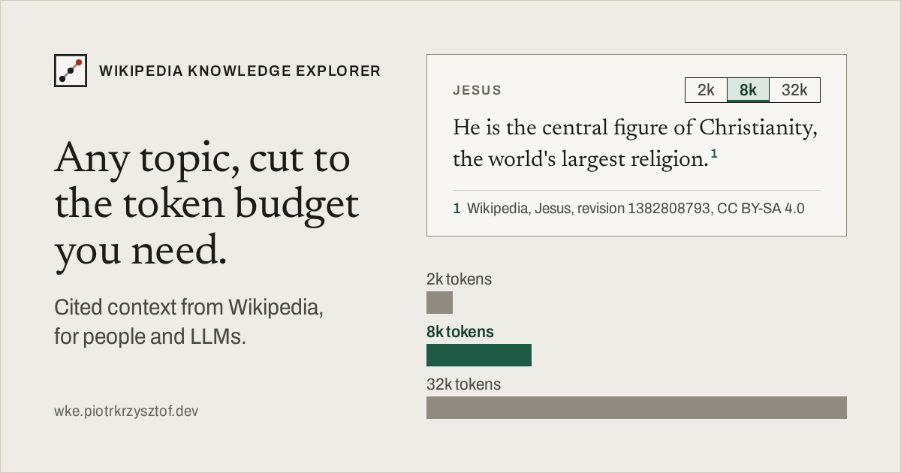
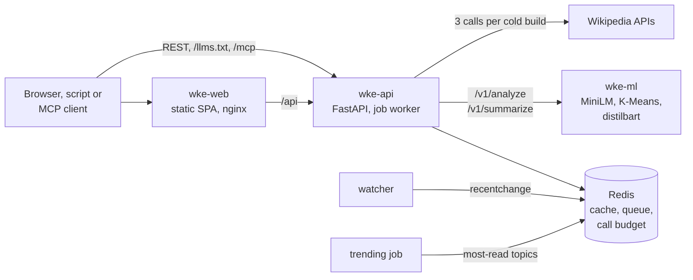

<p align="center">
  
</p>

<div align="center">

[Live application](https://wke.piotrkrzysztof.dev)

[](https://github.com/straightchlorine/wke/releases)
[](https://github.com/straightchlorine/wke/actions/workflows/ci.yml)
<br>
[](https://github.com/straightchlorine?tab=packages&repo_name=wke)
<br>
[](https://hub.docker.com/r/straightchlorine/wke-api)
[](https://hub.docker.com/r/straightchlorine/wke-ml)
[](https://hub.docker.com/r/straightchlorine/wke-web)

Turns a Wikipedia topic into a dossier pinned to one article revision, cut to a token budget.



</div>

## Architecture



- `wke-api` serves REST, MCP and `/llms.txt` and runs the job worker, the watcher and the
  trending job. It does not import torch.
- `wke-ml` embeds and clusters sections and, on request, summarises. Without it the API
  groups sections by article structure instead.
- `wke-web` is a React single-page app served by nginx.
- Redis holds the job queue, the dossier cache and the Wikimedia call budget.

A cold build costs three Wikimedia calls and a warm read costs none.

## What it does

- Builds a dossier from an article title, pinned to the revision current at build time
- Clusters sections by embedding similarity and cites every passage to that revision
- Packs the result to 2000, 8000 or 32000 tokens
- Serves a web page, Markdown, JSON, `/llms.txt` and an MCP server
- Shows yesterday's most-read topics as a concept graph on the home page
- Adds model summaries only with `?summaries=true`, each labelled as model output

## Running locally

You need Docker with Compose; without Docker also [uv](https://docs.astral.sh/uv/),
[pnpm](https://pnpm.io/) and [just](https://github.com/casey/just).

```bash
cp backend/api/.env.example backend/api/.env
# set WKE_CONTACT_EMAIL: a mailbox or an https URL, sent in the Wikimedia User-Agent
docker compose -f docker-compose.dev.yml --profile ml up --build
```

Open <http://localhost:8080>, not `:5173` or a container address: the CORS settings name
`localhost:8080`. Leave `--profile ml` out to run without wke-ml.

```bash
curl -s -X POST http://localhost:8080/api/v1/dossiers \
  -H 'content-type: application/json' -d '{"title": "Alan Turing"}'
curl -s 'http://localhost:8080/api/v1/dossiers/1208.md?budget=8000'   # once built
```

Without Docker, `just up` starts Redis, wke-ml, wke-api, the watcher and a web preview
(Linux; run `pnpm install` in `frontend/app` once), and `just down` stops them. The
per-service commands are in the READMEs under `backend/` and `frontend/app/`.

## Tests

```bash
cd backend/api && uv run pytest --cov=wke --cov-fail-under=85
cd backend/ml && uv run pytest
cd frontend/app && pnpm run verify && pnpm run verify:e2e
```

The backend tests replay recorded Wikimedia responses and run offline.

## API and MCP

The REST contract is [backend/api/openapi.yaml](backend/api/openapi.yaml); endpoints and
settings are in [backend/api/README.md](backend/api/README.md).

| Entry point | Path |
|---|---|
| Build or read a dossier | `POST /api/v1/dossiers`, `GET /api/v1/dossiers/{page_id}[.md]` |
| Poll a build | `GET /api/v1/jobs/{job_id}` |
| Models | `GET /llms.txt`, `/mcp` with `search_topics`, `get_dossier`, `get_trending` |


## Licence

Code: MIT, see [LICENSE](LICENSE).

Third-party material keeps its own licence (fonts, model weights, Wikipedia text);
see [NOTICE](NOTICE).

Article text served through WKE is from English Wikipedia under CC BY-SA 4.0.
